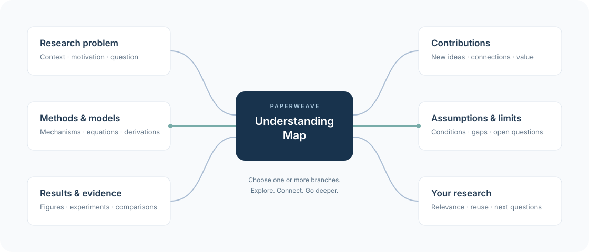

# PaperWeave

English | [Chinese (Simplified)](README.zh-CN.md)

**A general-purpose AI skill for understanding papers, finding key passages, and resolving questions.**

Open this folder in your local AI workspace and start with [weave.md](weave.md).
PaperWeave guides the agent from a concise understanding map to focused discussion
of the models, evidence, and questions that matter to you.

## Get started

Use an AI app that can read local files and PDFs. Saving notes also requires file
write access. PaperWeave itself needs no package installation or server.

1. Download or clone this repository and open the folder in your AI app.
2. Put a paper in `private/papers/`, or provide its local path.
3. Send:

   ```text
   Read weave.md and follow it to help me read this paper: <PDF path>
   ```

The agent follows the reading workflow from there. Apps that load [AGENTS.md](AGENTS.md)
can discover the entry point automatically; otherwise, name `weave.md` explicitly.
The entry uses skill-style YAML metadata and Markdown instructions, with the core
workflow maintained in [MAIN.md](MAIN.md). Its custom filename requires explicit
loading in clients that only auto-discover `SKILL.md`. Keep the full repository.

## Start with a map, explore the branches

The skill first outlines the paper's structure and builds an **Understanding Map**:
different directions for exploring its research problem, methods, results, and limits.
Choose **one or several branches** to explore, switch directions, or ask how branches
connect. Each deeper explanation points to pages, equations, or figures so you can
locate the passages that deserve a closer read.



This is a reading-navigation sketch; branches expand with the paper and your questions.
Try "Explore the methods and results," then "How does this assumption affect the
results?" Say "save" to keep your judgment.

## Keep what matters

You can specify your preferred language for saved content, and the agent remembers
your choice. Notes and searchable indexes are written under `private/` when you
ask to save; they are not automatically committed or pushed to Git. You control
what you track and share. Empty `private/papers/` and `private/notes/` folders are
included via `.gitkeep` files, ready to use. Git ignores all PDFs, personal Markdown
files under `private/`, and temporary outputs in `private/tmp/`.
No personal library is included. On your first save, the agent creates the local
notes and indexes automatically after confirming your language preference.

The workflow is defined in [MAIN.md](MAIN.md), with focused rules for
[reading](prompts/READ.md), [saving](prompts/SAVE.md), and a [note template](templates/NOTE.md).

**Reading the original paper is irreplaceable; analysis only helps you quickly
understand it and locate relevant content.**
