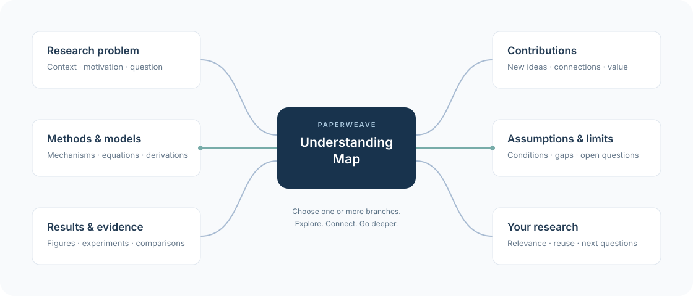

# PaperWeave

[English](README.md) | 简体中文

**一款通用 AI 论文阅读 Skill，帮助你快速理解、定位原文、解答疑惑。**

在本地 AI 工作区打开这个文件夹，以 [MAIN.md](MAIN.md) 为入口即可开始。
PaperWeave 引导 AI 先给出简洁的论文理解地图，再围绕你关心的模型、证据和问题深入讨论。

## 开始使用

使用能读取本地文件与 PDF 的 AI 应用；保存笔记还需要文件写入权限。
PaperWeave 本身无需安装软件包或启动服务。

1. 下载或克隆本仓库，在 AI 应用中打开文件夹。
2. 将论文放入 `private/papers/`，或提供论文的本地路径。
3. 发送：

   ```text
   阅读 MAIN.md，按照其中的流程帮我阅读这篇论文：<PDF 路径>
   ```

AI 随后会按流程开展阅读。能加载 [AGENTS.md](AGENTS.md) 的应用可自动发现入口；
其他应用显式指定 `MAIN.md` 即可。这是一套以 `MAIN.md` 为入口的 Markdown 工作流。

## 从理解地图开始，沿着分支深入

Skill 先梳理论文结构，给出一张 **理解地图（Understanding Map）**，
把研究问题、方法、结果和局限等整理成不同的理解方向。
你可以选择**一个或多个分支**深入，也可以随时切换方向、交叉追问。
每次深入都会结合原文页码、公式或图表，帮助你找到需要细读的位置。



上图是阅读导航示意，分支会随论文与问题继续展开。例如：“先深入方法和结果”，
接着追问“这个模型假设如何影响结果？”；说“保存”即可留下你的判断。

## 保留有价值的内容

AI 会先询问保存内容使用中文还是英文，并记住你的选择。
你要求保存时，笔记和可检索索引会写入 `private/`，不会自动提交或推送到 Git。
由你决定跟踪和分享哪些文件。仓库通过 `.gitkeep` 保留 `private/papers/` 和
`private/notes/` 空目录，克隆后即可使用；个人内容和 PDF 默认被 Git 忽略。
仓库不附带个人文献库。首次保存时，AI 会在确认语言偏好后自动创建本地笔记与索引。

完整流程见 [MAIN.md](MAIN.md)，具体规则分为[阅读](prompts/READ.md)、
[保存](prompts/SAVE.md)与[笔记模板](templates/NOTE.md)。

**原文阅读无法替代，分析只是帮助快速理解和定位。**
